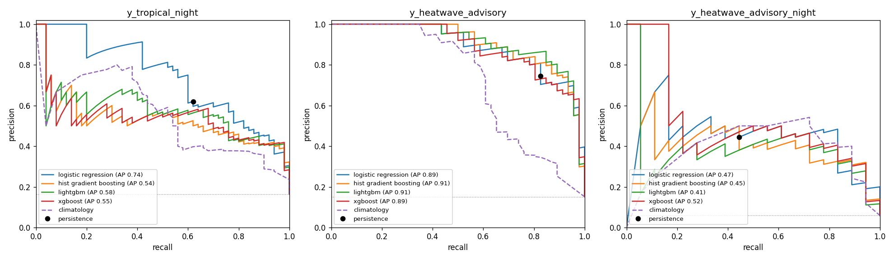

# Next-Day Heatwave and Tropical Night Prediction for Daegu

KNU Big Data project · Final report · October 2026
Authors: Jeremi Wojciech Barciński, Tenzin Dorjee

---

## 1. Summary

We built models that use the weather of one day (D) to predict whether the **next day (D+1)** in Daegu
will be part of a **heatwave advisory**, a **tropical night**, or both. We used 13 summers (2014-2026) of
official hourly measurements from the KMA ASOS station in Daegu (station 143).

On the held-out test years (2025-2026):

- **Tropical night**: logistic regression catches 85% of tropical nights with a PR-AUC of 0.71,
  clearly better than the simple baselines (PR-AUC 0.44-0.50).
- **Heatwave advisory**: LightGBM ranks days better than the baselines (PR-AUC 0.80 vs 0.69) and gives
  better probabilities. But at the chosen threshold its yes/no decisions are slightly worse than the
  simple rule "if today is hot, tomorrow is hot" (F1 0.78 vs 0.81).
- **Advisory + hot night**: XGBoost catches 82% of these days (baselines: 39-50%), but more than half of
  its warnings are false alarms (precision 0.41).
- **Tomorrow's maximum feels-like temperature**: predicted with an average error of 1.44 degC, compared
  with 1.64 degC for "same as today".

---

## 2. Problem

Daegu is one of the hottest cities in South Korea. The KMA (Korea Meteorological Administration) issues
heat warnings based on the **feels-like temperature**. Feels-like temperature combines air temperature
with humidity.

| event | definition used in this project |
|---|---|
| Heatwave advisory | daily maximum feels-like temperature >= 33 degC for 2 or more consecutive days |
| Heatwave alarm | daily maximum feels-like temperature >= 35 degC for 2 or more consecutive days |
| Extended alarm | daily maximum feels-like temperature >= 35 degC for 3 or more consecutive days |
| Tropical night | night minimum **air** temperature (18:01-09:00) >= 25 degC |
| Advisory + hot night | heatwave advisory **and** night minimum air temperature >= 26 degC (Daegu regional threshold) |

**Task:** at the end of day D, using only data up to 23:00 of D, predict whether day D+1 meets each
definition. We also predicted tomorrow's maximum feels-like temperature (regression).

---

## 3. Data

### 3.1 Choice of dataset

We first collected **ERA5** data from Open-Meteo. ERA5 is model-based weather data, which we combined with
Open-Meteo air quality data. The air quality part only starts in August 2022 (so the cleaned ERA5 file
covers 2023-2026), and the data are not measured at the station. We therefore switched to **ASOS**: official hourly measurements
from the KMA station in Daegu (station 143). All modeling uses ASOS only; the ERA5 pipeline is not
finished.

| | ASOS (KMA) | ERA5 (Open-Meteo) |
|---|---|---|
| source | measured at the weather station | reanalysis model based on satellite and other observations |
| downloaded | 2000-2026, hourly | weather 2020-2026, air quality from 2022-08-04, hourly |
| variables kept | 12 (after cleaning) | 16 (10 weather + 6 air quality) |
| used | 2014-2026 (the station moved in 2013) | not used for modeling (cleaned file: 2023-2026) |

### 3.2 Collection and cleaning (`A_ASOS_01`, `A_ASOS_02`, `A_ASOS_02_after_report`)

- **Download:** the data were downloaded month by month from the KMA API Hub (322 raw files) and merged
  into one hourly file of 234,600 rows (2000-2026). The time axis is complete, with no missing hours.
- **Missing-value codes:** KMA marks missing values with codes such as `-9` and `-99`. These were turned
  into missing values (NaN). Care was needed because `-9.0` can also be a real winter temperature.
  Night-time solar radiation and sunshine codes were set to 0.
- **Short gaps:** gaps of 3 hours or less were filled by linear interpolation.
- **Removed columns:** two columns were dropped because they had too many missing values after 2014:
  - `cloud_cover_tenths` (100% missing in 2014, 57% in 2015)
  - `visibility_10m` (100% missing in 2014, 35% in 2015)
- **Analysis window:** 2014-01-01 onwards, 111,864 hourly rows.

### 3.3 Daily feature table (`A_ASOS_03_make_features.py`)

- **Feels-like temperature:** computed for every hour with the KMA summer formula, using Stull's
  wet-bulb temperature.
- **Daily values:** the hours were combined into daily values (min / max / mean / sum). A day needs at
  least 20 valid hours.
- **Targets:** all targets were computed on the full continuous series, then shifted to D+1.
- **Season:** only May-September was kept, because tropical nights and heatwaves occur only from June to
  September.
- **Result:** 1,976 days with 60 features:

| group | examples |
|---|---|
| today's weather (26) | temperature / feels-like / humidity / dew point (min, max, mean), pressure, wind, solar radiation, sunshine, ground temperature, rain |
| recent history | values from 1, 2, 3 and 7 days ago; 3- and 7-day averages; pressure change; hot-day streaks (`hot33_streak`); last night's minimum and the tropical-night streak |
| season | day of the year as a circle (`doy_sin`, `doy_cos`) |

**Chronological split** (rows are never shuffled, because neighbouring days are very similar):

| split | years | days | used for |
|---|---|---|---|
| train | 2014-2022 | 1,368 | fitting the models |
| val | 2023-2024 | 304 | choosing models, settings and thresholds |
| test | 2025-2026 | 304 | final evaluation, used **once** |

**Share of positive days per split (%):**

| target | train | val | test |
|---|---|---|---|
| tropical night | 12.6 | 16.4 | 19.7 |
| heatwave advisory | 9.3 | 15.1 | 21.4 |
| advisory + hot night | 4.1 | 5.9 | 9.2 |
| heatwave alarm | 0.4 | 1.0 | 1.0 |
| extended alarm | 0.0 | 1.0 | 1.0 |

The two alarm targets have almost no positive days (no extended alarm at all in 2014-2022), so they were
not modeled.

Hot days have become more frequent over the period. For example, there were 12 tropical nights in 2014,
37 in 2024 and 32 in 2026 (up to 29 September). As a result, the test years contain clearly more hot days
than the training years.

---

## 4. Method (`A_ASOS_04_modeling.py`)

1. **Baselines.** Every model must beat two simple rules:
   - *Persistence*: tomorrow is like today. For the advisory: today's feels-like max >= 33 degC. For the
     tropical night: last night >= 25 degC.
   - *Climatology*: how often the same time of year (+-7 days) was positive in the training years.
2. **Models:**
   - logistic regression (missing values filled with the median, features scaled)
   - three tree-based gradient-boosting models: scikit-learn `HistGradientBoosting`, **LightGBM** and
     **XGBoost**
3. **Tuning.** A small grid of settings was tested with **expanding-window cross-validation by year**
   inside train: train 2014-2016 -> check 2017, train 2014-2017 -> check 2018, ..., up to 2022.
   Settings were scored with PR-AUC.
4. **Class imbalance.** Weighting the rare hot days more (`class_weight="balanced"`) was included as a
   tuning option. In most cases the models were better without it. For logistic regression on tropical
   nights, the weighting did not improve the ranking (PR-AUC 0.734 vs 0.742) and doubled the probability
   error (Brier 0.164 vs 0.080). The imbalance is handled by the decision threshold instead.
5. **Model choice.** For each target, the model with the highest PR-AUC on val was chosen. In every case
   it was also the best in cross-validation.
6. **Decision threshold.** For each target, the threshold is the highest one that still catches
   **at least 80% of the positive days on val** (recall >= 0.8). For a heat warning, a missed hot day is
   worse than a false alarm. The threshold was then fixed.
7. **Final test.** The chosen models were refitted on train + val and evaluated **once** on test.
   Nothing was changed after seeing the test results.

**Metrics.** Accuracy is not used: a model that always says "no" would score 80-95%. Instead we report:

- **PR-AUC**: how well the model ranks hot days above normal days
- **precision**: share of warnings that were correct
- **recall**: share of hot days that were caught
- **F1**: a balance of precision and recall
- **Brier score**: error of the predicted probabilities (lower is better)

For the regression target we report MAE and RMSE in degC.

---

## 5. Results

### 5.1 Model selection on val (2023-2024)

| target | logistic regression | HistGB | LightGBM | XGBoost | chosen |
|---|---|---|---|---|---|
| tropical night | **0.742** | 0.540 | 0.579 | 0.545 | logistic regression |
| heatwave advisory | 0.893 | 0.906 | **0.912** | 0.887 | LightGBM |
| advisory + hot night | 0.472 | 0.445 | 0.407 | **0.518** | XGBoost |

(Values are PR-AUC on val.)



### 5.2 Final test results (2025-2026, evaluated once)

| target | model | positive share (%) | PR-AUC | precision | recall | F1 | Brier |
|---|---|---|---|---|---|---|---|
| tropical night | persistence | 19.7 | 0.439 | 0.600 | 0.600 | 0.600 | 0.158 |
| | climatology | 19.7 | 0.502 | 0.456 | 0.867 | 0.598 | 0.131 |
| | **logistic regression** | 19.7 | **0.706** | 0.567 | 0.850 | **0.680** | **0.089** |
| heatwave advisory | persistence | 21.4 | 0.686 | 0.783 | 0.831 | **0.806** | 0.086 |
| | climatology | 21.4 | 0.629 | 0.519 | 0.862 | 0.647 | 0.136 |
| | **LightGBM** | 21.4 | **0.796** | 0.740 | 0.831 | 0.783 | **0.073** |
| advisory + hot night | persistence | 9.2 | 0.222 | 0.423 | 0.393 | 0.407 | 0.105 |
| | climatology | 9.2 | 0.334 | 0.368 | 0.500 | 0.424 | 0.075 |
| | **XGBoost** | 9.2 | **0.579** | 0.411 | 0.821 | **0.548** | **0.056** |

**Regression: tomorrow's maximum feels-like temperature (degC)**

| model | val MAE | val RMSE | test MAE | test RMSE |
|---|---|---|---|---|
| persistence (today's value) | 1.63 | 2.16 | 1.64 | 2.21 |
| ridge regression | 1.46 | 1.87 | 1.46 | 1.91 |
| gradient boosting | 1.43 | 1.80 | 1.44 | 1.92 |

### 5.3 Which features matter

Permutation importance on val measures how much PR-AUC drops when one feature is shuffled. The top
features per target were:

| target | most important features |
|---|---|
| tropical night | tropical-night streak up to last night, time of year, mean ground temperature, hot-day streak, mean temperature / feels-like, minimum dew point |
| heatwave advisory | today's mean feels-like temperature (by far), time of year, today's maximum feels-like temperature |
| advisory + hot night | mean feels-like temperature, minimum dew point, maximum ground temperature, minimum temperature, east-west wind |

The results make physical sense:

- Heat persists from one day to the next, which explains the importance of streaks and today's
  temperature.
- Humid air (high dew point) slows down cooling at night, so the night stays warm.
- Warm ground releases heat during the night.
- The time of year marks the peak of summer (late July to mid-August).

### 5.4 Errors (val, at the chosen threshold)

| target | missed hot days | false alarms | when |
|---|---|---|---|
| tropical night | 10 | 37 | false alarms mostly in July-August |
| heatwave advisory | 9 | 6 | misses spread over July-September |
| advisory + hot night | 3 | 22 | false alarms mostly in August |

The false alarms are the price of the recall >= 0.8 rule. Most of them fall in the hottest weeks, on days
that are close to the threshold.

---

## 6. Discussion

- **Tropical night is where the model adds the most.** The simple rules reach F1 0.60; the model reaches
  0.68 while catching 85% of the nights. A simple linear model works best here, probably because the
  relationship is close to linear (warmer and more humid -> warmer night) and the data set is small.
- **Heatwave advisory: persistence is very strong.**
  - Because an advisory is a *run* of hot days, "today is hot -> tomorrow is hot" is right most of the time.
  - The model ranks days better and gives better probabilities, which is useful for a risk score.
  - But as a yes/no warning at our threshold, it raises a few more false alarms than persistence.
  - Its PR-AUC also fell from 0.91 on val to 0.80 on test, so the val result was optimistic.
  - An honest conclusion: the model is a useful probability score, and it should be compared with (or
    combined with) the persistence rule.
- **Advisory + hot night is the hardest target.** It has the fewest positive days (about 4% in training).
  The model catches most events, but its precision of about 0.4 means many false alarms.
- **Class weighting is not always helpful.** For these data, unweighted models with a tuned threshold gave
  the same ranking and much better probabilities.
- **The climate signal is visible in the data.** The share of hot days rises from train to test. All
  comparisons are therefore made within the same split.

---

## 7. Limitations

1. **Heatwave labels look ahead.** A heatwave is a run of consecutive hot days, so the label for D+1 also
   depends on D+2 (and on D+3 for the extended alarm). This is part of the official definition, not a
   data error, but it makes the task partly a 2-day forecast.
2. **Hourly vs 10-minute data.** KMA uses 10-minute data for the official daily maximum and minimum. Our
   hourly data give slightly lower extremes, so days close to a threshold can be classified differently
   from the official record.
3. **Computed feels-like temperature.** We computed the feels-like temperature with the KMA formula
   ourselves; it was not downloaded from KMA.
4. **Small test set.** The test set has only 304 days (2026 ends on 29 September) and few positive days
   (28 for advisory + hot night), so the test numbers are noisy.
5. **One station, no forecast input.** The models only use what was measured at one station up to day D.
   Weather forecasts or data from neighbouring stations could improve the predictions.
6. **Alarms not modeled.** The heatwave alarm and extended alarm have too few positive days to train on.

---

## 8. Conclusion and future work

Using only one day of station measurements, next-day **tropical nights** in Daegu can be predicted clearly
better than with simple rules. **Heatwave advisories** are predicted well, but mostly because heat persists
from day to day: the model mainly adds better probabilities over the persistence rule.

Possible next steps:

- Add the ERA5 / air quality variables once that dataset is ready.
- Add neighbouring stations or numerical weather forecasts as inputs.
- Combine the model with the persistence rule.
- Collect more years, or use several stations, so that the alarm targets can also be modeled.

---

## Appendix: how to reproduce

```bash
pip install pandas numpy scikit-learn matplotlib lightgbm xgboost
brew install libomp            # macOS only (needed by lightgbm and xgboost)
python A_ASOS_01_fetch_daegu_asos.py        # needs the KMA_API_KEY environment variable
python A_ASOS_02_clean_asos.py
python A_ASOS_02_clean_asos_after_report.py
python A_ASOS_03_make_features.py
python A_ASOS_04_modeling.py                # EVALUATE_TEST = True was the single final run
```

Detailed numbers are in `ASOS_04_model_results.csv` and `ASOS_04_modeling_report.txt`.
